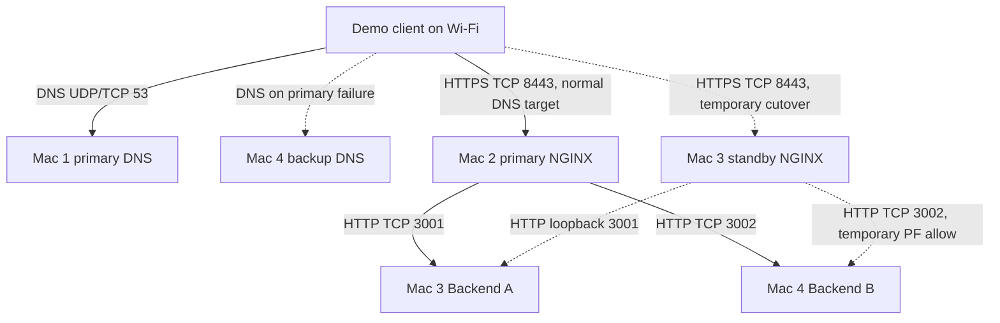

# Phase 2 topology and request flow

All four Macs share the private Wi-Fi LAN. See the [IP and service inventory](IP-inventory.md) for ports and machine assignments.

1. **DNS.** The client queries for `app.team1.test` on UDP/TCP 53. Either resolver replies with the same 30-second A record, which can be cached by the OS.
2. **TCP and IP.** The client opens a connection from an ephemeral TCP port to the resolved IP on port 8443. SYN, SYN-ACK and ACK establish the connection over the LAN.
3. **TLS.** The client sends the hostname in SNI. NGINX presents the edge certificate, and the client verifies the certificate and hostname before sending the HTTP request.
4. **HTTP.** The edge terminates TLS and opens a separate HTTP connection to an upstream backend. The backend response includes `X-Backend`, `Cache-Control` and `ETag`. The edge delivers the response to the client over TLS. During cutover the standby also adds `X-Edge: standby-mac3`.
5. **Isolation.** Backend PF rules allow the primary edge over Wi-Fi. The standby reaches A over loopback and gets a temporary rule on B. Clients use HTTPS through an edge.
